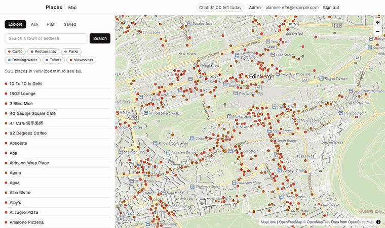

# Places

A map-based "ask about places" web app. Browse OpenStreetMap places on a map,
search for them, and (with invited access) ask Claude about them. Claude answers
by calling tools that search a PostGIS cache of OpenStreetMap, streams its reply,
and puts the places it mentions on the map. An agent plans multi-stop trips in
the background, with a human approval step.

**Live demo: <https://d1u3hzq737vhqg.cloudfront.net>.** The map and place search are
open to everyone. Chat and the trip planner are invite-only, because every
answer costs real money: request access from the site.



What it demonstrates:

- **LLM integration:** streaming tool use over server-sent events, prompt
  caching, per-call token and cost logging, per-user daily budgets, and evals of
  tool choice.
- **Agentic AI:** a hand-written plan → act → check → revise loop with
  guardrails, persisted and resumable runs, step tracing and human approval.
- **Geospatial:** PostGIS spatial queries, and a grid cache in front of Overpass
  that keeps the app inside its usage policy.
- **Production habits:** magic-link auth with server-side sessions, tests on
  every feature, CI on every PR, and AWS deployment with Terraform, GitHub OIDC
  and a required reviewer.

> **Status:** Phases 1 to 5 are done: foundation, maps, Claude chat, cloud
> deployment and the agent trip planner. See the [roadmap](CLAUDE.md#roadmap).

## Architecture

```
 Browser ──► CloudFront ──► Next.js (App Router, :3000)   same origin: no CORS
                               │  Server Components, Server Actions and route
                               │  handlers call the API server-side,
                               │  forwarding the session cookie
                               ▼
                            FastAPI (:8000) ──► Postgres + PostGIS (:5432)
                               │  ├─ chat: streamed tool-use loop
                               │  └─ agent worker: background trip-planner runs
                               │
                               ├──► Anthropic API (Claude)
                               ├──► Overpass (places), Nominatim (geocoding)
                               └──► SES (magic-link email)
```

FastAPI owns all data, auth and LLM calls. Next.js never talks to Anthropic or
the database directly, and the browser never talks to FastAPI directly. In
production all three containers run on one EC2 instance behind CloudFront (see
[Production stack](#production-stack) and [infra/](infra/README.md)).

| Layer    | Tech                                                                 |
| -------- | -------------------------------------------------------------------- |
| Frontend | Next.js 16 (App Router, Cache Components), TypeScript, Tailwind v4   |
| Backend  | FastAPI, Pydantic v2, pydantic-settings, SQLAlchemy 2.0 async, Alembic |
| Database | Postgres 17 + PostGIS 3.5                                            |
| Tooling  | uv, ruff, pyright, pytest · pnpm, ESLint, Prettier · pre-commit, gitleaks |
| LLM      | Claude (Haiku 5.5 by default) via the official `anthropic` SDK       |
| CI       | GitHub Actions                                                       |
| Cloud    | AWS: EC2, CloudFront, S3, SES, SSM · Terraform                       |

## Repo layout

```
backend/
  app/
    main.py        app factory, middleware, router registration
    config.py      typed settings from env vars (pydantic-settings)
    db.py          async engine + session factory
    deps.py        shared dependencies (DB session, current user, chat access)
    cli.py         management commands (`python -m app.cli make-admin ...`)
    observability.py  Sentry error reporting (off without SENTRY_DSN; no personal data)
    security.py    random token generation and hashing
    models/        SQLAlchemy models
    schemas/       Pydantic request/response schemas
    routers/       API endpoints (APIRouter)
    services/      business logic
      agent.py     the hand-written agent loop (plan, act, check, revise) and its guardrails
      trip_planner.py  the trip planner task: prompt, submit_plan, itinerary check, walk estimates
      agent_worker.py  drives agent runs in the background; a sweeper resumes interrupted ones
  alembic/         database migrations
  evals/           chat tool-use and trip-planner evals (real model, frozen map data; manual)
  tests/
frontend/
  app/             routes (App Router)
  lib/api.ts       server-only API client (forwards the session cookie)
  lib/auth-actions.ts  Server Actions for sign-in and sign-out
  lib/access-actions.ts  Server Actions for requesting access and the admin page
  app/admin/usage/ Claude spend page (chart in plain HTML/CSS, no chart library)
  app/admin/agent/ agent runs and each run's step-by-step trace
  app/map/         the map page (MapLibre GL, a Client Component) and its Ask/Plan/Saved tabs
  app/api/         route handlers the map, chat and planner call from the browser (proxy to FastAPI)
  lib/chat.ts      chat types and the server-sent events (SSE) reader
  lib/agent.ts     trip planner types and how each step is described
  lib/markdown.tsx tiny Markdown renderer for chat replies (React elements only)
  app/api/health/  overall health, checked through CloudFront after each deploy
  proxy.ts         refuses requests that didn't come through CloudFront (production)
  instrumentation*.ts, sentry.*.config.ts  Sentry setup (lib/sentry-options.ts holds the settings)
  scripts/         copy-maplibre-worker.mjs (see Decisions)
docker-compose.yml       development stack (source mounted, auto-reload)
docker-compose.prod.yml  production stack (see "Production stack")
scripts/backup-db.sh     database backup (pg_dump, checked, optional upload to S3)
scripts/restore-db.sh    restore a dump (local file or S3), all-or-nothing
ops/systemd/             nightly backup and daily cleanup timers, installed by each deploy
scripts/deploy-on-server.sh  run on the server by the deploy workflow (pull, migrate, start)
infra/bootstrap/         Terraform: state bucket, GitHub OIDC deploy role, budget
infra/app/               Terraform: network, server, CloudFront, ECR, backups, SES, settings
```

## Local setup

### Prerequisites

- Docker (Docker Desktop on Windows/macOS; on WSL, enable WSL integration for your distro)
- For running tools outside Docker and for the git hooks:
  [uv](https://docs.astral.sh/uv/), Node 24 with pnpm (`corepack enable pnpm`), and
  [pre-commit](https://pre-commit.com/) (`uv tool install pre-commit`)

### Run everything with Docker

```bash
cp .env.example .env
docker compose up --build
```

- App: http://localhost:3000. The status card should show API OK, Database Connected, and the PostGIS version.
- API: http://localhost:8000/health, with interactive docs at http://localhost:8000/docs.

Migrations run automatically when the backend container starts.

After pulling changes that add dependencies, rebuild the affected image. For
the frontend, also renew its `node_modules` volume. Running `pnpm install`
inside the running container can leave its packages half-linked.

```bash
docker compose up -d --build backend
docker compose up -d --build --renew-anon-volumes frontend
```

### Signing in locally

Sign-in uses a magic link, with no passwords. In development, emails are not
sent. The link is printed to the backend log instead:

1. Go to http://localhost:3000/login and enter any email address.
2. Find the link: `docker compose logs backend | grep -A4 "sign-in link"`
3. Open it and press **Sign in**.

Which sender is used is set by `EMAIL_BACKEND`: `console` (the default, above) or `ses`, which
sends through Amazon SES from `EMAIL_FROM` with the server's AWS credentials. Production uses
`ses`; its settings come from Parameter Store (see `infra/README.md`).

Links expire after 30 minutes and work once. Sessions last 30 days. Both
values are settings in `backend/app/config.py`, overridable by environment
variables (`LOGIN_LINK_LIFETIME_MINUTES`, `SESSION_LIFETIME_DAYS`).

### Chat access (invite-only)

Anyone can sign in, but chat needs a **chat grant**. To give yourself admin
rights and a grant (the equivalent of Django's `createsuperuser`):

```bash
docker compose exec backend python -m app.cli make-admin you@example.com
```

Each grant has a **daily budget in US dollars**, estimated from the tokens
each Claude call uses and resetting at midnight UTC. A grant with no budget of
its own uses `CHAT_DAILY_BUDGET_USD` ($1.00). Setting `CHAT_MODE=open` lets
every signed-in user chat with the default budget. `GET /chat/access` reports
your status and today's spend.

How someone gets access:

1. They fill in the form at http://localhost:3000/request-access
   (`POST /access-requests`). Every admin gets an email.
2. An admin approves or denies it on http://localhost:3000/admin. Approving
   creates their account if needed, creates a grant with an optional daily
   limit, expiry and note, and emails them a sign-in link.
3. On the same page, admins can edit a grant's limit, expiry or note, or revoke
   it. Changes take effect on the user's next request.
4. **Claude spend** (http://localhost:3000/admin/usage, `GET /admin/usage?days=30`)
   shows the estimated cost over the last 7, 30 or 90 days: totals, a chart of spend per UTC
   day, and breakdowns by user and by model, from the `llm_usage` ledger.
5. **Agent runs** (http://localhost:3000/admin/agent, `GET /admin/agent/runs`) lists
   everyone's trip-planner runs. Each opens a trace of every step exactly as the
   model saw it: model calls with their text, tool calls, tokens, cost and time;
   tool calls with the output sent back; checks with the problems found; and any
   feedback. Thinking signatures are never sent out, even to admins.

The site header shows each signed-in user how many chat tokens they have left
today, or a "Request chat access" link if they have no grant. Admins also see
an **Admin** link. The underlying endpoints are documented at
http://localhost:8000/docs.

### Map data

`GET /places?bbox=west,south,east,north&category=cafe` returns places as
GeoJSON. They come from OpenStreetMap through the
[Overpass API](https://wiki.openstreetmap.org/wiki/Overpass_API) and are
cached in PostGIS:

- The world is divided into a fixed grid of cells about 2 km across. The first
  request for an area fetches its cells from Overpass in one query, for every
  category at once. Later requests within 30 days (`PLACE_CACHE_DAYS`) are
  answered from PostGIS alone.
- The public Overpass server asks apps that use it regularly to stay under
  about 100 queries and 10 MB a day, in total across all users. The backend
  counts its calls in `upstream_calls` and stops at `OVERPASS_DAILY_QUERY_BUDGET`
  (80) or `OVERPASS_DAILY_MB_BUDGET` (8). It runs one query at a time, and
  backs off exponentially when the server is busy (30 s, doubling to 10 min).
- When it can't fetch, it still returns what's cached, with
  `"complete": false` and an `incomplete_reason` (`budget`, `cooldown`,
  `upstream_error` or `busy`).
- Set `OSM_CONTACT` in `.env` so the User-Agent identifies you, as the
  usage policies ask.
- The default instance is the community-run `ovp.dresel.systems`, because the
  main `overpass-api.de` was often at capacity during development. Point
  `OVERPASS_URL` at any other
  [public instance](https://wiki.openstreetmap.org/wiki/Overpass_API#Public_Overpass_API_instances)
  to change it. The budgets follow the main instance's stricter policy
  whichever you use.

### Claude chat

Chat needs an Anthropic API key in `.env`. Use a key dedicated to this
project, created in a workspace with a spend limit in the
[Claude Console](https://platform.claude.com). Without a key the app runs
normally and the chat endpoints answer 503.

| Setting | Default | What it does |
| --- | --- | --- |
| `ANTHROPIC_API_KEY` | (empty) | Backend only. Never in a `NEXT_PUBLIC_*` variable. |
| `CHAT_MODEL` | `claude-haiku-5-5` | The model the app's chat calls. It must have prices in `backend/app/services/pricing.py`, or the backend won't start. |
| `CHAT_EFFORT` | `low` | How much the model reasons: `low` to `max`. Higher costs more. |
| `CHAT_DAILY_BUDGET_USD` | `1.00` | Default daily spend per user. Per-user amounts are set on `/admin`. |
| `CHAT_MAX_TOKENS` | `16000` | Output cap for every call (thinking counts towards it). |
| `CHAT_MAX_MESSAGE_CHARS` | `2000` | Longest message a user can send. |
| `CHAT_MAX_TOOL_STEPS` | `6` | Most tool steps per message. After that, one last call with tools disabled makes the model answer with what it has. |

Compose passes the whole `.env` to the backend, so changing one of these
means editing `.env` and running `docker compose up -d backend`.

`POST /chat/conversations/{id}/messages` streams the reply as server-sent
events: `text`, `tool_start` / `tool_result` (what it's looking up, with
places to show on the map), `error`, and always a final `done`.

**Tools.** Claude answers from the app's own data with four tools, backed by
the same services as the map. That means the Overpass and Nominatim budgets
and caches apply to chat too:

| Tool | What it does |
| --- | --- |
| `find_location` | Geocodes a place name (Nominatim, cached) |
| `search_places` | Places of given categories within a radius, nearest first (PostGIS cache, Overpass on a miss) |
| `get_place_details` | Opening hours, address, website and other OSM tags for one place |
| `save_place` | Saves a place to the user's list (`GET` / `DELETE /saved-places`) |

**What the map shows.** Each message carries the map view: its centre, how
far it reaches, and the selected place's ID, if any. The backend turns that
into a short `<map_view>` note before the user's words, taking the place's
name from the database. So "more details on 1802 Lounge", or "cafés near
here", means the area on screen rather than anywhere in the world. Naming a
town ("cafés in Leith") still works as before. The note is stored with the
message, so replays are exact, but it's hidden from the transcript.

**Folding and deleting questions.** In the Ask panel, earlier questions fold
to one line when a new one is sent (▸/▾ toggles each one). × deletes a
question and everything the assistant did to answer it:
`DELETE /chat/conversations/{id}/messages/{question_id}`. The deleted text is
removed from the database, so later replies can't see it, and the
conversation's title moves to the next question. Claude's thinking blocks
are signed against the whole conversation before them, so removing a turn
from the middle would make the API reject every later one. Deleting a turn
therefore also strips the thinking blocks from the rest of the conversation.
The visible answers stay, and the prompt cache restarts once.

**The conversation list.** Conversations are a stack of rows, like an
accordion. Clicking a row opens that conversation, with its message box,
beneath it (an open row's heading is its first question, which isn't
repeated below; with later questions, its answer folds behind a small
"First answer" line); clicking it again closes it and opens a new conversation at the
top. The × at the end of a row deletes the whole conversation
(`DELETE /chat/conversations/{id}`). Its messages go with it, but its usage
rows stay, so the day's spend still counts. Deleting a conversation's last
question deletes the conversation too, and the list leaves out
conversations with no saved messages (for example one whose first message
failed).

**Place names are links.** A **bold** name in an answer that matches a place
the assistant found while writing it (by search or lookup) is a link.
Clicking it shows the place on the map and starts a new conversation with
"Tell me more about …" typed in, but not sent, since every question costs
money. Only names of found places link, so bold labels like "Opening hours:"
stay plain. When a conversation is reopened, each answer comes back with the
places from its turn's tool results (`places` on the message), so the links
survive a reload.

**"Tell me more" on a place.** The card that opens when you click a place on
the map has a **Tell me more** button. It switches to the Ask tab and sends
"Tell me more about {name}." in a new conversation straight away: clicking
the button is the decision to ask. The place stays selected, so the map view
sent with the question gives the assistant its `place_id` to look up. If the
panel is still loading or finishing another answer, the question waits and is
sent once it's free.

Tests use a scripted fake model. One
opt-in test calls the real API for a fraction of a cent:
`RUN_LIVE_CLAUDE=1 uv run pytest tests/test_chat_live.py -s`.

### The map

http://localhost:3000/map shows a vector map (MapLibre GL with
[OpenFreeMap](https://openfreemap.org) tiles; no API key). Zoom in to level 13
or closer and places load for the visible area, refreshing as you pan. You can
filter by category, search for a place (on submit), and click a place for its
opening hours, website and a link to OpenStreetMap.

The side panel has four tabs:
- **Explore:** the search, filters and list above.
- **Ask:** chat with the assistant, for invited users. Replies stream in, each
  tool step shows as a status line ("Searching cafés within 500 m · Found 27
  places"), and the places it finds appear on the map as larger, outlined
  markers.
- **Plan:** the trip planner, for invited users. Describe an outing ("coffee,
  then a park, near Leith Walk, back by 4") and watch the agent work: each
  search, each proposal and any problems the check found appear as they
  happen. The checked itinerary shows as a card with times and walking legs,
  and on the map as numbered markers joined by a dashed line. Approve it, send
  it back with changes, or cancel. The run lives on the server, so closing the
  tab doesn't stop it, and reloading reopens it where it is.
- **Saved:** places the assistant saved for you.

To use another tile
provider, set `NEXT_PUBLIC_MAP_STYLE_URL` to its style URL. Tile keys are
public by design.

### Place search (geocoding)

`GET /geocode?q=Leith Walk` finds towns, streets and addresses with
[Nominatim](https://nominatim.openstreetmap.org), following its
[usage policy](https://operations.osmfoundation.org/policies/nominatim/):

- **At most one request per second** across the whole backend. Searches queue
  for their turn, and give up as "busy" after 5 seconds.
- **Every answer is cached for 30 days, including "no results"**. The policy
  warns that clients repeating the same query may be blocked.
- **Search on submit, never on each keystroke.** Autocomplete is forbidden.
  Each IP may make 20 searches a minute.
- The same exponential backoff as Overpass, a daily safety budget
  (`NOMINATIM_DAILY_QUERY_BUDGET`, 1000), and older cached results
  (`"stale": true`) if Nominatim can't be reached.

### Evals

`backend/evals/chat_tools/` is an eval of the chat's tool use. It runs 26 questions
through the real chat code with the real model, against frozen Edinburgh map data.
It grades whether the right tools were called with sensible arguments (`tool_use`, checked
in code) and whether the answer only states what the tools returned (`grounded`, checked
by a Sonnet 5.5 judge). The baseline on Haiku 5.5 is **98% tool_use and 81% grounded**. See
`.claude/hillclimb/chat-tools/metrics.md` for the metrics, the limitations and the findings.

```bash
cd backend
uv run python -m evals.chat_tools.run_eval --approve-harness  # after reviewing any eval change
uv run python -m evals.chat_tools.run_eval --reps 2 --variant v1  # a new variant (~$0.55, mostly the judge)
uv run python -m evals.chat_tools.run_eval --regrade           # re-judge stored answers only
uv run python -m evals.chat_tools.check_judge                  # judge sanity checks (~$0.08)
```

Runs use real API calls, so they're manual, never in CI. The runner refuses to run if
its runner, grader, cases or fixture changed since you last approved them. The grader's
code checks have offline tests (`tests/test_eval_grader.py`) that run in CI. Results go
to `.claude/hillclimb/chat-tools/<variant>/`; the report is built with the Claude API
skill's `build-report-lite.mjs`.

`backend/evals/trip_planner/` is a goal-based eval of the trip planner. Twelve goals
("Starting at 2pm from the Royal Mile: a viewpoint, a café and a toilet stop, back by
4pm") run through the worker's own entry point (`drive_run`), so the real loop, tools,
check and guardrails are all measured, on the same frozen map data. Grading is all code
(`grade.py`), no judge: `success` means a plan passed the app's check *and* matches what
the goal asked for (start, categories, number of stops, return, time limits, deadline);
`first_try` means the model's first proposal was already valid. The runner records model
calls, cost and latency too, and `--report` compares variants, e.g. two models.

```bash
cd backend
uv run python -m evals.trip_planner.run_eval --dry-run          # free: a scripted model
uv run python -m evals.trip_planner.run_eval --approve-harness  # after reviewing any eval change
uv run python -m evals.trip_planner.run_eval --reps 2           # Haiku 5.5 (the default)
uv run python -m evals.trip_planner.run_eval --reps 2 --variant sonnet --model claude-sonnet-5-5
uv run python -m evals.trip_planner.run_eval --report           # variants side by side
```

The dry run plans every goal with a scripted model through the same code. It costs
nothing, shows the fixture can satisfy every goal, and runs in CI along with the
grader's tests (`tests/test_trip_eval_grader.py`). Paid runs are manual. Shared
plumbing for both evals (eval database, fixture, stubs, harness gate) is in
`evals/common.py`.

### Production stack

`docker-compose.prod.yml` is what runs on the server, and you can run it locally too:

```bash
docker compose -f docker-compose.prod.yml build
docker compose -f docker-compose.prod.yml run --rm migrate   # apply migrations
FRONTEND_PORT=3100 docker compose -f docker-compose.prod.yml up -d
scripts/backup-db.sh                                         # pg_dump (scripts/restore-db.sh restores)
```

It uses the `prod` stages of the Dockerfiles. The backend has no dev dependencies, runs as a
non-root user with a single uvicorn worker and no reload, and writes JSON logs. The frontend is a
Next.js `standalone` server running as the `node` user. Only the frontend publishes a port.
Migrations are an explicit step. Settings come from `ENV_FILE` (`.env` by default). CI builds both
production images on every PR.

Deploying to AWS is set up in `infra/` (Terraform). `infra/README.md` walks through account
security, SSO sign-in for the CLI, the one-time bootstrap, the GitHub `production` environment,
and the app stack (server, CloudFront, image registry, backups, email, settings), with costs and
known limitations. In production the frontend serves only requests carrying CloudFront's secret
`X-Origin-Verify` header (`frontend/proxy.ts`); locally, with `ORIGIN_VERIFY_SECRET` unset, it serves
everything.

**Deploys** (`.github/workflows/deploy.yml`) run after CI passes on `main`, once you approve
them. The workflow builds both images and pushes them to ECR, tagged with the commit. It then tells
the server, through SSM Run Command, to run `scripts/deploy-on-server.sh`. That script writes the
env file from Parameter Store, pulls, migrates, starts, and waits for every health check. Last,
the workflow checks `/api/health` through CloudFront. To roll back, run the workflow by hand with
an earlier commit.

### Git hooks (once per clone)

```bash
pre-commit install
```

Every commit is then checked for secrets (gitleaks) and linted and formatted (ruff, Prettier).

### Backend commands

Run from `backend/`. The tests need the database, so start it with `docker compose up -d db`.
Like Django, they never use the database in `DATABASE_URL` directly: they run against a
sibling `<name>_test` database (e.g. `app_test`), which pytest creates and migrates
automatically, so your dev data can't affect test results.

```bash
uv sync                                       # install deps into .venv
uv run fastapi dev app/main.py                # run API on the host (auto-reload)
uv run pytest                                 # tests
uv run ruff check . && uv run ruff format .   # lint + format
uv run pyright                                # type check
uv run alembic upgrade head                   # apply migrations
uv run alembic revision --autogenerate -m "add places"   # new migration (review it!)
```

### Frontend commands

Run from `frontend/`:

```bash
pnpm install
pnpm dev            # http://localhost:3000 (uses API_URL, default http://localhost:8000)
pnpm lint
pnpm typecheck
pnpm format
pnpm build
```

## CI

GitHub Actions (`.github/workflows/ci.yml`) runs on every PR and on pushes to `main`:

- **Backend:** ruff lint and format check, pyright, Alembic migrations, and pytest against a PostGIS service container (in its own `app_test` database)
- **Frontend:** Prettier check, ESLint, TypeScript, and `next build`
- **Secrets:** gitleaks over the full git history

## Decisions

| Decision | Why |
| --- | --- |
| **FastAPI owns data, auth and LLM calls** | One trust boundary. The Anthropic key and DB credentials live only in the backend. |
| **Async SQLAlchemy 2.0 + asyncpg** | FastAPI is async end to end, and blocking DB calls inside `async def` would stall the event loop. |
| **Settings via pydantic-settings** | Typed, validated at startup, and configured with env vars only (12-factor). |
| **`/health` checks the DB and PostGIS** | One endpoint serves the status page, the container healthcheck and a smoke test. It returns 503 when the DB is down. |
| **Initial migration enables PostGIS** | The Docker image enables it already, but managed Postgres (e.g. RDS) doesn't. The migration keeps the schema reproducible. |
| **Tests use a real PostGIS database** | Spatial behaviour can't be meaningfully faked with SQLite or mocks. |
| **Server Components fetch via a `server-only` module** | `API_URL` and the session cookie never reach browser JavaScript. |
| **Map view goes in the user's message, not the system prompt** | The system prompt stays byte-for-byte identical, so prompt caching keeps working whatever the map shows. Sending the view with every message, rather than only when no place is typed, avoids guessing what counts as a location. Claude decides, and an explicitly named town wins. |
| **Deleting a question really deletes it, and strips later thinking** | "Forget this" should mean the assistant can't see it any more, not just that it's hidden. History is otherwise append-only, because Claude's thinking signatures bind each block to the conversation before it. Removing all thinking blocks is the documented way to keep the history valid after an edit. |
| **Magic-link sign-in, no passwords** | Invited users (e.g. recruiters) never need to create a password, and there are no password hashes to protect. |
| **Server-side sessions, not JWTs** | The cookie holds a random token and the DB stores only its SHA-256 hash. Sign-out and revocation take effect immediately, as with Django's DB sessions. A JWT can't be revoked before it expires without a server-side denylist. |
| **Browser talks only to Next.js** | The session cookie belongs to the frontend's origin and Next.js forwards it to FastAPI server-side. No CORS, no cross-site cookies, and FastAPI can live on a private network in production. |
| **Sign-in link needs a button press** | Email security scanners open links in advance. If a GET request signed you in, a scanner could use up the single-use token first. |
| **Identical response for any email** | `POST /auth/login-link` always returns 202 with the same body, so it can't be used to find out who has an account. It is also rate-limited per address. |
| **Alembic connects with `search_path=public`** | The `postgis/postgis` image puts its `tiger` and `topology` schemas on the search path, and autogenerate would otherwise try to drop their tables. |
| **Tests roll back a transaction** | Each test runs in a transaction that is rolled back afterwards, like Django's `TestCase`, so tests are isolated and leave the DB clean. |
| **Chat gated by a single dependency** | Every chat and agent route depends on `require_chat_access`, which returns 401 (not signed in), 403 (no active grant) or 429 with `Retry-After` (daily budget used up). One place to audit, and opening chat to everyone is just `CHAT_MODE=open`. |
| **Budgets in dollars, summed from a usage ledger** | Every Claude call writes a row to `llm_usage` with its tokens, including cache reads and writes, and an estimated cost from a per-model price table. Dollars rather than tokens, because cached, uncached and output tokens differ in price by up to 50x, so a token count says little about what a user actually costs. The daily budget is the sum of today's `cost_usd`, checked before each call, so the most a call can go over is its `max_tokens`. |
| **Claude behind a small `ChatModel` interface** | The chat service never imports the SDK. `AnthropicChatModel` streams through `AsyncAnthropic`, and tests use a scripted fake, so the whole flow is tested without network calls or API cost. |
| **Chat history stored exactly as sent** | Each message's API content blocks are stored as JSONB and replayed unchanged, including thinking blocks, whose text is empty but whose signature must be kept. History is append-only: editing earlier turns would invalidate replayed thinking and the prompt cache. A failed call saves nothing, so history never has a question without its answer. |
| **A hand-written tool loop** | Calling the model, running the tools it asks for, and calling it again is a short loop in `app/services/chat.py`, not the SDK's tool runner. Owning it is what allows a budget check before every call, a cap on tool steps, SSE events for each tool, and saving the turn only when it can be replayed. |
| **A hand-written agent loop, not a framework** | The trip planner's loop (`app/services/agent.py`) is one readable module: call the model, run the tools it asks for, check its proposal in code, feed problems back, pause for a person's approval. Every guardrail (model calls, cost and time per run, the daily budget) is an `if` before a model call, and it's all tested with a scripted fake model. A framework would hide exactly the parts worth showing. |
| **Agent proposals checked by code, not another model** | A proposal (the finish tool's input) passes only if a deterministic check says so; its problems go back to the model as the tool's result, and the model revises. Code checks are free, repeatable and can't be talked round, and the same check grades the evals. |
| **Agent state is its steps** | Every model call, tool call, check and piece of feedback is saved as an `agent_steps` row the moment it happens, and the conversation is rebuilt from them before each call. So the trace an admin reads is the run's actual state, and a run interrupted by a restart carries on from its last step (its heartbeat goes stale, and the next worker claims it). Each step stores the exact text sent to the model, so replays are byte-identical. |
| **Agent runs driven by an in-process worker, not a task queue** | A run takes a minute or two, so it can't live in the request that starts it. The API queues it in `agent_runs` and an asyncio task drives it; a sweeper picks up anything nobody is driving (including runs interrupted by a deploy) every minute. The table is the queue, and the conditional claim makes double-starts harmless, so there's no Celery, Redis or SQS to run. With one backend process that's enough; more processes would still be safe, just not load-balanced. |
| **Progress streamed from the database, not from the worker** | `GET /agent/runs/{id}/events` polls the run's saved steps twice a second and sends new ones as server-sent events, with keep-alives every 15 s (CloudFront drops an origin that is silent for 60 s). Because it only reads saved steps, a dropped connection loses nothing: the browser reconnects with the last `seq` it saw. |
| **Itineraries checked against the database** | A trip plan passes only if every stop was returned by a search in that run, the start came from a location lookup, each requested category is covered by a stop's real category, no walk is over 4 km, and it fits the user's time limits. Names, categories and coordinates are then filled in from the database, so the plan the user approves can't contain anything the model made up. |
| **Walking times estimated, not routed (for now)** | Straight-line distance × 1.3 at 4.8 km/h, labelled as an estimate in every plan. Good enough to sequence a few stops in a neighbourhood, and free. Real routing (#16) can replace one function without touching the agent or the check. |
| **Run status changes are conditional updates** | `UPDATE ... WHERE status IN (...)`, so two workers can't both claim a run and a cancel always wins: the loop finds out at its next heartbeat. No locks are held while waiting on the model. |
| **Strict tool schemas instead of eager input streaming** | Tool inputs here are tiny (coordinates, a place name), so streaming them early gains nothing. `strict: true` makes the API guarantee inputs match the schema. Bounds that strict schemas can't express (radius 50–2000 m, note length) are enforced by Pydantic, and an out-of-range value goes back to Claude as an error it can correct. |
| **Only replayable turns are saved** | A turn that ends on an unanswered or cut-off tool call (refusal, `max_tokens`, budget running out, API failure) would be rejected when replayed, so its messages are dropped. Every call's cost is still logged. |
| **One reply at a time per conversation** | Sending locks the conversation row with `FOR UPDATE NOWAIT`. A double-submitted message gets "busy" rather than a second, interleaved reply. |
| **`PATCH` sends only the fields that change** | The handler uses `model_dump(exclude_unset=True)`, so `{"daily_token_limit": null}` (go back to the default) differs from leaving the field out (keep it as it is). |
| **SES through boto3 in a worker thread** | boto3 is the official AWS SDK but it blocks, so each send runs in `anyio.to_thread` rather than stalling the event loop. A whole async AWS SDK (aioboto3) would be a heavier dependency for one call per sign-in. Emails go out from background tasks, so a failed send is logged rather than surfacing to the user. |
| **Approval email includes a `/login` fallback** | Sign-in links expire after 30 minutes, but an approval email may not be read for days. |
| **One active grant per user, enforced by Postgres** | A partial unique index (`WHERE revoked_at IS NULL`) rather than an app-level check, so two simultaneous approvals can't both succeed. Revoked grants are kept as history. |
| **Places cached by grid cell** | Panning around an area costs at most a few upstream queries, and each cell is fetched once for every category. Cells, rather than exact bboxes, make "have we fetched this?" a simple primary-key lookup. |
| **Overpass budget kept in the database** | The `upstream_calls` table is shared by every backend process and survives restarts. An in-memory counter would reset on each deploy and count per process. |
| **Incomplete results instead of errors** | When Overpass is busy or the budget is used up, the map still shows cached places and says why some are missing, rather than failing. |
| **Rate limits use the real client IP** | Requests reach FastAPI through Next.js, so the visitor's IP is in `X-Forwarded-For`. It's only trusted from `TRUSTED_PROXIES`, and read right to left, so clients can't dodge limits with a fake header. The counters are in memory for now; several backend instances would need Redis. |
| **Map data via Next.js route handlers** | The map is browser code, so it can't use Server Components to fetch on every pan. `/api/places` and `/api/geocode` forward to FastAPI server-side, so the browser still only talks to the Next.js origin and FastAPI stays private. |
| **Per-IP limits trust the edge proxy** | Next.js only fills in `X-Forwarded-For` when the request doesn't already have one, so with nothing in front of it (local dev) a client could fake its IP. In production CloudFront appends the real address, and FastAPI reads the header right to left. Per-IP limits are for fairness; the OSM usage budgets are enforced across the whole backend, so faked IPs can't push us over them. |
| **MapLibre's worker is copied into `public/`** | MapLibre parses tiles in a Web Worker that it loads from a URL it works out at runtime, which bundlers can't follow. `pnpm dev` and `pnpm build` copy the installed worker to `public/vendor/` (gitignored), and the map calls `setWorkerUrl`. |
| **Chat goes through Next.js route handlers too** | The browser streams replies from `/api/chat/...`, which forwards to FastAPI with the session cookie and passes the server-sent events straight through as they arrive. For requests that change data, the handler also refuses a foreign `Origin` header, as a second CSRF defence behind the SameSite=Lax cookie. |
| **A tiny Markdown renderer, not a library** | Chat replies only need paragraphs, lists and bold. The renderer builds React elements, so model output is always escaped (no `dangerouslySetInnerHTML`), and there's no new dependency. |
| **OSM links only if http(s)** | Anyone can edit OSM tags, so a `website` tag could be a `javascript:` URL. The details panel only links http and https addresses. |
| **Agent evals graded against the goal, in code** | The app's check already proves a plan is valid (real places, short legs, times that add up), so the eval asks the remaining question: is it the plan the user asked for? Each case lists what the goal requires (start, categories, deadline...) and code compares the plan to it. No judge model means grading is free, exact and repeatable, so comparing models costs only the runs. |
| **Evals call the real entry point with stubbed external services** | The eval runs `chat.stream_reply` with the real model and real tools, so prompt, tool and loop changes are all measured. Only Overpass and Nominatim are replaced, by a frozen fixture and a gazetteer, so runs are reproducible and cost nothing in OSM usage. |
| **Tool use graded in code, grounding by a judge** | Whether the right tools were called with sensible arguments is checkable in code: properties, not an exact sequence. Whether an answer invents places or facts needs judgement, so a different model (Sonnet 5.5) grades it from per-claim verdicts, checked by known-negative tests. |
| **One EC2 instance running Docker Compose** | About $22 a month, against about $50 for Fargate + RDS + ALB, which matters for a demo. The production compose file mirrors development, so local and server run the same images. The trade-offs: no high availability, a short restart on deploy, and the database's backups are ours to manage (nightly `pg_dump` to S3, with a tested restore). |
| **CloudFront reaches the server over a firewalled public address** | CloudFront *VPC origins* would keep the server private, but a private server needs a NAT to reach Anthropic and OpenStreetMap, and a managed NAT gateway costs about $37 a month. Instead the server has a public address whose firewall admits only CloudFront's origin-facing ranges. Because those ranges are shared by all CloudFront customers, the app also requires a secret header that only our distribution adds (`frontend/proxy.ts`). The CloudFront-to-server hop is plain HTTP; see `infra/README.md`, "Known limitations". |
| **x86 (t3a.small), not ARM (t4g.small)** | The official PostGIS image has no ARM build. x86 costs about $1.50 a month more, but every image runs as-is and CI builds without emulation. |
| **The database on its own EBS volume** | The server is disposable (rebuilt from Terraform and the deploy); the data volume is protected from `terraform destroy` and survives replacing the instance. Nightly dumps to S3 cover losing the volume itself. |
| **Deploys through SSM Run Command, not SSH** | No port 22, no SSH keys to store or rotate. GitHub gets short-lived AWS credentials through OIDC, which are only issued to jobs in the approved `production` environment, and the command runs as an audited SSM invocation. The command carries the compose file and deploy script with it, so the server never needs access to the repository. |
| **Images tagged with the commit, immutable** | A tag always means the same code, so a redeploy or rollback reuses the image already in ECR instead of rebuilding something slightly different. |
| **Scheduled jobs as systemd timers on the host** | Backups need the host's AWS CLI and the compose project, so a timer on the server is simpler than a scheduler container or a cloud service. `Persistent=true` catches up after downtime, `journalctl` keeps the output, and each deploy installs the units, so they're versioned with the code. |
| **The cost chart is HTML and CSS, not a chart library** | One column chart doesn't justify a dependency. It's a Server Component, so the page ships no JavaScript of its own. Each column is focusable, with a CSS tooltip and an accessible name, and the same numbers are in a table. |
| **Sentry for errors, with personal data off** | Errors arrive grouped, with stack traces and the release they came from, without anyone searching logs. Sentry's defaults would send user identity, IPs, cookies, headers, bodies, query strings, stack-frame variables and Claude prompts, so each of those is switched off explicitly and tested (a real event is captured and inspected). Query strings are also cut from URLs, because sign-in links carry their token there. It's off without a DSN, so development and tests send nothing. |
| **Dev and prod stages in one Dockerfile** | Shared base image and dependency layers. `dev` bind-mounts the source with reload; `prod` copies only what runs, with no dev dependencies, as a non-root user. |
| **Migrations as a deploy step, not on startup** | Running `alembic upgrade` when a container starts races if two start at once, and hides a failed migration behind a crash loop. In production it's a one-off `migrate` service the deploy runs first. |
| **pyright over mypy** | Faster, and the same engine as VS Code's Pylance, so editor and CI agree. |
| **uv and pnpm** | Fast, lockfile-first package managers with reproducible installs. |
